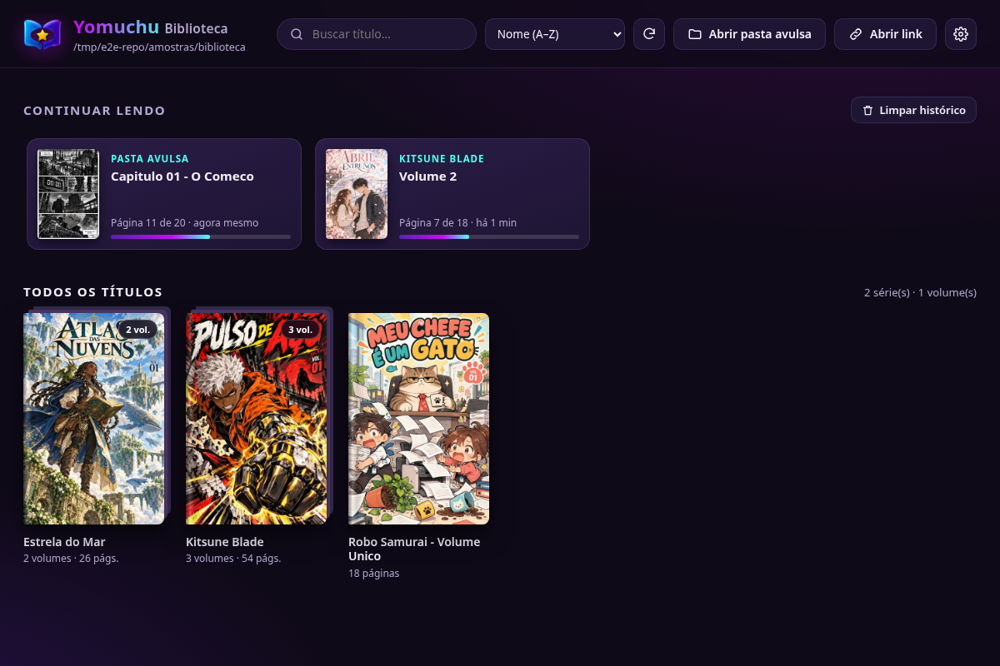
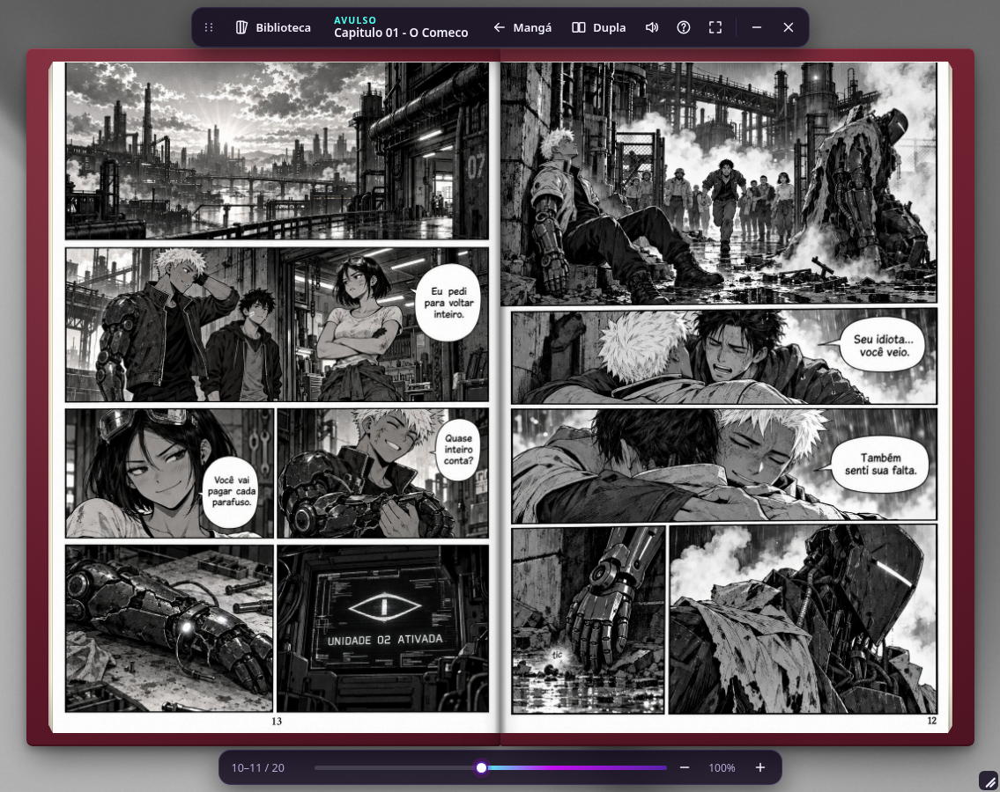

# Yomuchu


Leitor de mangá e quadrinhos para **Windows e Linux**, feito com Electron.
As páginas aparecem num **livro virtual que flutua sobre a área de trabalho**: janela sem bordas,
fundo transparente, duas páginas abertas com lombada, capa dura, pilha de folhas nas laterais e
virada de página em 3D com curvatura, sombra e som de papel.




## Instalar e abrir

| Sistema | Arquivo (aba **Releases** do GitHub) | Como usar |
|---|---|---|
| Windows (instalador) | `Yomuchu-0.4.1-win-x64.exe` | Dê dois cliques e siga o instalador. O Windows pode mostrar o aviso "SmartScreen" porque o app não tem assinatura digital: clique em **Mais informações → Executar assim mesmo**. |
| Linux (qualquer distro) | `Yomuchu-0.4.1-linux-x86_64.AppImage` | `chmod +x Yomuchu-*.AppImage` e execute. Precisa do FUSE 2 (`sudo apt install libfuse2`, ou `libfuse2t64` no Ubuntu 24.04+). |

Também dá para abrir uma pasta direto pela linha de comando: `yomuchu "/caminho/do/volume"`.

## Como a biblioteca funciona

1. Clique em **Escolher pasta da biblioteca** (ou arraste uma pasta para a janela).
2. O programa olha as subpastas dessa pasta principal:
   - uma subpasta **com imagens** vira um **volume**;
   - uma subpasta **só com outras pastas** vira uma **série**, e as pastas de dentro viram os volumes (`Série/Volume 1`, `Série/Volume 2`…);
3. A capa é a primeira imagem de cada volume. As miniaturas ficam guardadas em cache, então a biblioteca abre rápido da próxima vez.
4. As páginas (JPG, JPEG, PNG e WebP) são ordenadas pela **ordem natural** dos nomes: `1, 2, 10` (e não `1, 10, 2`), `pagina2` antes de `pagina10`.
5. O programa lembra a **página onde você parou** em cada volume, a pasta da biblioteca, as preferências e o tamanho e a posição das janelas. A seção **Continuar lendo** mostra o que você começou.

Exemplo de organização:

```
Mangás/                    ← pasta principal da biblioteca
├── One Piece/             ← série
│   ├── Volume 01/         ← volume (001.jpg, 002.jpg, ...)
│   └── Volume 02/
└── Akira - Volume Único/  ← volume direto na raiz
```

Também há **Abrir pasta avulsa** para ler qualquer pasta sem colocá-la na biblioteca.
Na biblioteca, clique com o botão direito numa capa para **ler do início**, **marcar como não lido** ou **abrir a pasta**.

## Lendo

- **Virar página:** setas do teclado, clique na página, arraste o canto da folha (ela acompanha o mouse) ou use a roda do mouse.
  Passe o mouse perto da borda da página para ver o canto levantar.
- **Modo mangá (padrão):** leitura da direita para a esquerda, com a capa sozinha como num mangá japonês.
  O botão **Mangá / Ocidental** (ou a tecla `D`) troca a direção, e a escolha fica salva.
- **Página única / dupla:** botão ou tecla `M`.
- **Mover a janela:** arraste a alça `⠿` ou o título na barra de cima, ou a **borda da capa** (a moldura vermelha em volta das páginas).
  Arrastar **sobre as páginas** só mexe na folha, nunca na janela. **Redimensionar:** canto inferior direito.
- A barra de ferramentas some sozinha e volta quando você mexe o mouse.

### Atalhos

| Tecla | Ação |
|---|---|
| `←` `→` | Virar página (seguindo a direção de leitura) |
| `PgDn` / `Espaço` · `PgUp` / `Shift+Espaço` | Próxima · anterior |
| `Home` / `End` | Capa / última página |
| `F11`, `F` ou duplo clique | Tela cheia (`Esc` sai) |
| `Ctrl` + roda, `+` / `-` | Zoom (arraste para mover a página, `0` volta ao normal) |
| `D` | Mangá (dir.→esq.) / Ocidental (esq.→dir.) |
| `M` | Página única / dupla |
| `S` | Liga/desliga o som de página |
| `B` | Voltar à biblioteca |
| `?` | Mostrar os atalhos |
| Biblioteca: `Ctrl+O`, `Ctrl+F`, `F5` | Abrir pasta avulsa, buscar, atualizar |

## Transparência no Linux e opções

- No Linux, o fundo transparente precisa de um **compositor** (GNOME, KDE e XFCE com compositor ligado já têm).
  Sem compositor, a área em volta do livro fica preta.
- Se isso acontecer, em **Configurações** (engrenagem na biblioteca) desligue **Fundo transparente no leitor** ou ligue
  **Desativar aceleração de vídeo (GPU)**, e reinicie o app. Também dá para abrir com:
  - `yomuchu --sem-transparencia` (livro sobre um fundo escuro)
  - `yomuchu --disable-gpu`
- Os dados ficam em `config.json` na pasta de dados do app:
  - Windows: `%APPDATA%\Yomuchu\`
  - Linux: `~/.config/Yomuchu/`

## Novidades da versão 0.4.1

- **Logo novo** (livro azul e roxo com estrela dourada num balão) como ícone **principal e pequeno**. A fonte da verdade é o `.ico` feito pelo usuário, guardado em `build/icones-fonte/favicon-yomuchu.ico` (quadros de 16, 32, 48, 64, 128 e 256 px). `build/icon.ico` é uma cópia dele **com os quadros originais intactos**; só foi acrescentado um quadro de 24 px (feito do de 32 px) para o Windows em 125% de escala. Os PNG (`build/icons/16x16…256x256.png`, `icon-small.png`, `src/favicon.png`) são extraídos dos quadros dele; o de 512 px (Linux, `build/icon.png`) e o logo do cabeçalho (`src/logo.png`, 192 px) vêm de `build/icones-fonte/yomuchu-logo.png` (512×512, fundo transparente).
- `python3 tools/gerar_icones.py` refaz tudo (precisa de `pip install pillow numpy`). Se o `.ico` do usuário não existir, o script gera todos os tamanhos só a partir do `yomuchu-logo.png` (plano B: de 48 px para cima, redução direta; em 16, 24 e 32 px o mesmo desenho com redução Lanczos, contorno um pouco mais grosso e nitidez suave). `python3 tools/folha_icones.py` cria uma folha de contato ampliada para conferir a legibilidade (`screenshots/icones-contato.png`).
- Os dois desenhos antigos (gato no livro e livro simples) ficam em `build/icones-fonte/anteriores/`.
- Usado em: ícone do `.exe`, instalador e desinstalador (NSIS), atalhos, Linux (AppImage/deb), ícone das janelas, `<link rel="icon">`, cabeçalho da biblioteca e aba Doar.

## Novidades da versão 0.4.0

- **Temas**: *Configurações → Aparência → Tema*: **Escuro** (padrão), **Claro** ou **Padrão do sistema**. Vale para as duas janelas (biblioteca e leitor: barras, diálogos, configurações, barra de progresso, barras de rolagem…), muda ao vivo e é lembrado na configuração (`theme`).
- **Fundo do leitor** (a cor atrás do livro): amostras prontas (padrão, transparente, lilás, roxo, azul-claro, preto, cinza escuro, roxo escuro, azul escuro, marrom escuro, claro) e um seletor de cor livre. O **Padrão** mantém o visual de sempre (janela transparente; escuro em tela cheia ou sem transparência); **Transparente** só aparece quando a janela do leitor é transparente e mantém a transparência também em tela cheia. Muda ao vivo e é lembrado (`backdrop`).
- **Papel envelhecido (sépia)**: liga/desliga mais a intensidade de 0 a 100% (padrão 50%). É um filtro de cor CSS (`sepia() saturate() contrast() brightness()`) aplicado às páginas, à pilha de folhas e às duas faces da folha que vira, em página dupla/simples e em tela cheia. Não mexe na física da virada. Desligado por padrão (`sepia`, `sepiaLevel`).
- Todos os textos novos estão nos 18 idiomas (o árabe segue em RTL).

### Onde mudar as cores

Tudo fica em **um arquivo só: `src/shared/theme.css`** (usado pela biblioteca e pelo leitor). No topo estão as 3 cores da marca:

| Variável | Cor | Uso |
|---|---|---|
| `--lilac` | `#c210ef` | botões primários, destaques, itens ativos |
| `--purple` | `#5623ab` | superfícies de destaque, 2º tom do degradê dos botões |
| `--aqua` | `#4ffff0` | foco, barras de progresso, links e pequenos realces |

Logo abaixo ficam os "papéis" de cada tema (`--bg`, `--panel`, `--text`, `--muted`, `--accent`, `--link`, `--focus`, `--grad`, `--grad-progress`, sombras…). O tema escuro é o `:root`; o claro é `:root[data-theme="light"]`, que só redefine o que muda. Os arquivos `library.css` e `reader.css` usam apenas essas variáveis. O texto sobre botões lilás/roxo é branco (`--on-accent`): o contraste é ≥ 4,5:1 (WCAG AA); se mudar uma cor, ajuste o texto, não a cor da marca. No tema claro o azul-claro não tem contraste como texto, por isso links e rótulos usam o roxo e o azul-claro fica nos realces e no fim das barras de progresso. As cores do fundo do leitor ficam em `src/library/library.js` (`BACKDROPS`), a intensidade do sépia em `src/shared/theme.js` (`sepiaFilter`). O livro em si (capa vinho, papel) continua com as cores originais (`reader.css`: `.board`, `--paper`).

## Novidades da versão 0.3.1

- **Abrir pasta**: quando um download de "Abrir link" termina, o diálogo continua aberto com a mensagem de sucesso e o botão **Abrir pasta**, que mostra no gerenciador de arquivos a pasta do capítulo recém-baixado. Há também um **Abrir pasta** ao lado de "Apagar baixados" nas Configurações e dentro da série "Baixados de links", que abre a pasta `baixados` (dentro dos dados do app; ela é criada se ainda não existir).
- Segurança: o processo principal só abre caminhos que, depois de resolvidos (inclusive atalhos simbólicos), ficam *dentro* da pasta `baixados`; qualquer outro caminho é recusado.
- Nos testes (`YOMUCHU_TEST_LINKS=1`) nenhuma janela do sistema é aberta: o caminho que seria aberto é só registrado.

## Novidades da versão 0.3.0

- **Abrir link** (botão na biblioteca ou `Ctrl+L`): cole o endereço da página de um capítulo; o Yomuchu procura as
  páginas, baixa para uma pasta temporária com barra de progresso (e **Cancelar**) e abre no leitor como uma pasta
  local. Os capítulos ficam na série **"Baixados de links"** da biblioteca, para reabrir sem internet; em
  **Configurações** há o tamanho ocupado e o botão **Apagar baixados** (também no menu do volume).
  > **Use apenas com conteúdo que você tem o direito de ler.** O Yomuchu não contorna login, paywall, captcha nem
  > proteção (DRM): se o site bloquear, o app mostra a mensagem e para.
- **Como as imagens certas são escolhidas** (`src/linkfetch.js`, constantes `PROFILE` e `LIMITS` no topo):
  1. coleta as URLs na ordem do documento (`src`, `data-src`, `data-original`, `data-lazy-src`, `srcset` (a maior),
     `<picture>`, `<noscript>`, URLs relativas, `<base>`), sem repetir;
  2. lê só o **cabeçalho** de cada uma (pedido `Range`; JPEG, PNG e WebP) para saber largura e altura;
  3. perfil de página de mangá: lado menor ≥ 500 px e maior ≥ 700 px, altura/largura entre 1,2 e 2,2 (páginas em pé),
     duplas deitadas até 2,4 de largura/altura; arquivos < 10 KB, GIF e SVG caem;
  4. fica o maior **grupo de resolução** (larguras dentro de ±15% da mediana) mais as duplas de ≈ 2× essa largura;
  5. baixa só as escolhidas (4 em paralelo, 2 novas tentativas, `Referer` da página, User-Agent identificado),
     descarta cópias idênticas (hash) e grava `001.jpg`, `002.jpg`… (a extensão vem do conteúdo).
  Se o HTML simples render menos de 3 páginas, a página é carregada numa **janela oculta** (JavaScript, rolagem para
  carregar imagens preguiçosas) e o tamanho vem dos `` já carregados.
- Segurança: só `http`/`https` (nunca `file://` etc., nem em redirecionamentos), limite de páginas (400), de tamanho
  por imagem (60 MB) e por capítulo (800 MB), nomes de pasta/arquivo saneados, exclusão só dentro da pasta de downloads.
- Limites honestos: tiras verticais (webtoon, proporção > 2,2) e sites que exigem login, captcha ou que montam as
  imagens com `blob:`/canvas não são suportados; se uma lista de "relacionados" for o maior grupo de imagens de
  mesmo tamanho, o filtro pode errar (ajuste as constantes).
- Teste: `tests/e2e.js` sobe um site falso local (`tests/fake_chapter.py` gera páginas e iscas) com lazy-load,
  `srcset`, `<noscript>`, dupla, versão montada por JavaScript, página sem capítulo, 403, 404 e redirecionamento perigoso.

## Novidades da versão 0.2.1

- **Páginas duplas:** imagens deitadas (largura maior que 1,1× a altura) ocupam o livro aberto inteiro, uma metade em
  cada folha. A paginação se ajusta sozinha: uma dupla sempre começa num livro aberto novo. Se uma página ficaria
  sozinha antes dela, entra uma página em branco, como nos leitores de mangá de verdade. A folha vira normalmente,
  levando metade da dupla.
  Em "página única" a dupla aparece inteira, reduzida para caber. Dá para desligar em **Configurações →
  Detectar páginas duplas automaticamente**.
- Amostra nova: `amostras/avulso/Capitulo 02 - Paginas Duplas` (hoje montada com a arte real por `tools/montar_amostras.py`; `tools/gerar_amostras_duplas.py --forcar` recria a versão placeholder).

## Novidades da versão 0.2.0

- Novo nome: **Yomuchu**, com ícone novo (gato no livro). O livro simples aparece nos tamanhos pequenos (16–32 px).
- **18 idiomas**: português, inglês, japonês, chinês, russo, espanhol, francês, alemão, coreano, árabe (interface da direita
  para a esquerda), hindi, italiano, turco, indonésio, vietnamita, tailandês, polonês e holandês.
  Escolha em **Configurações → Idioma**. "Padrão do sistema" segue o idioma do computador e usa inglês se ele não existir.
- Aba **Doar** nas configurações, com links para o GitHub, o site e a página de doação (abrem no navegador).
- Botão **Limpar histórico** em "Continuar lendo", com confirmação. Só apaga a lista e o progresso, nunca os arquivos.

## Onde mudar as coisas

| O quê | Onde |
|---|---|
| Nome do programa | `package.json`: `productName`, `build.productName`, `build.nsis.shortcutName`, `build.linux.desktop.entry.Name`; títulos das janelas em `src/main.js` (procure `'Yomuchu`) |
| Ícone / logo | troque `build/icones-fonte/favicon-yomuchu.ico` (ícone) e/ou `yomuchu-logo.png` (512 px) e rode `python3 tools/gerar_icones.py` |
| Textos / traduções | `src/locales/<idioma>.json`. Para um idioma novo, copie `en.json`, traduza e mude `lang.name` (e `lang.dir` para `rtl` se for da direita para a esquerda). Ele aparece sozinho no seletor |
| Links de doação | `src/library/library.html` (atributos `data-link`) **e** a lista `EXTERNAL_LINKS` em `src/main.js` (só links dessa lista abrem) |
| Física da página | objeto `PHYS` em `src/reader/reader.js` |
| Versão | `version` no `package.json` |

## Para desenvolvedores

Requisitos: Node.js 18+ (testado com Node 20) e Python 3 com Pillow (só para gerar amostras e ícones).

```bash
npm install
npm start                       # roda em modo de desenvolvimento
npm run start:opaco             # roda sem transparência
python3 tools/montar_amostras.py "<pasta com capas/ e páginas/>"  # monta amostras/ com a arte real
python3 tools/gerar_amostras.py --forcar  # volta às páginas de placeholder (sem --forcar não mexe na arte real)
python3 tools/gerar_icones.py   # recria os ícones a partir de build/icones-fonte/

npm run dist:linux              # AppImage (+ .deb) → dist/
npm run dist:win                # instalador NSIS + zip → dist/ (no Linux precisa do wine)
```

Teste automático ponta a ponta (Playwright + Electron), que também gera os prints de `screenshots/`:

```bash
# no Linux sem tela: Xvfb + compositor + gerenciador de janelas
Xvfb :99 -screen 0 1600x1000x24 & DISPLAY=:99 picom --backend xrender & DISPLAY=:99 xfwm4 --compositor=off &
DISPLAY=:99 node tests/e2e.js
```

### Estrutura

```
src/
  main.js              processo principal: janelas, protocolo manga://, varredura da biblioteca, config.json
  preload.js           ponte segura (contextBridge) entre a interface e o processo principal
  library/             janela da Biblioteca (HTML/CSS/JS)
  reader/              janela do Leitor: livro, virada 3D, zoom, som, barras
  i18n.js              aplica as traduções (atributos data-i18n no HTML)
  locales/*.json       um arquivo por idioma (18 idiomas, ~6 KB cada)
  favicon.png, logo.png  ícone pequeno (64 px) e logo (192 px) usados dentro das janelas (gerados por tools/gerar_icones.py)
build/                 ícones gerados (icon.ico, icon.png, icons/16x16…512x512)
  icones-fonte/        favicon-yomuchu.ico = o ícone do usuário (fonte da verdade) e yomuchu-logo.png = o logo de 512 px (troque aqui e rode tools/gerar_icones.py); anteriores/ = os dois desenhos antigos (gato no livro e livro simples)
tools/                 geradores de amostras e de ícones (Python/Pillow)
tests/                 teste ponta a ponta (tests/e2e.js) e gerador de quadros da animação
amostras/              mangás de teste com arte real: 6 capas + 12 páginas (a 11 é dupla), montados por tools/montar_amostras.py
                       (2 pastas avulsas + biblioteca com 3 títulos). Os geradores de placeholder não sobrescrevem
                       esta pasta enquanto existir amostras/.arte-real.
```

**Segurança:** `contextIsolation` ligado, `nodeIntegration` desligado, `sandbox` ligado, Content-Security-Policy restrita.
As imagens são servidas pelo protocolo próprio `manga://`, que só entrega imagens de dentro das pastas escolhidas pelo usuário.

**Como funciona a virada (física do papel):** a folha é feita de 14 tiras verticais encaixadas uma dentro da outra (`rotateY` com perspectiva).
Cada tira é um pequeno sistema mola-amortecedor ligado às vizinhas por uma rigidez de flexão, simulado a 240 Hz:
- uma mola puxa a folha para o destino (tecla/clique), para o mouse (arrastando) ou para o canto levantado;
- o ar freia mais a borda externa, que fica para trás e curva; uma turbulência faz uma onda correr pelo papel;
- ao chegar, a folha bate na página, quica e balança até assentar; ao soltar no meio do arrasto, ela segue com o próprio impulso;
- a página de baixo levanta um pouquinho com o ar, a luz de cada trecho segue a curvatura e a folha projeta sombra.
As constantes ficam no objeto `PHYS` em `src/reader/reader.js`.

**Mover a janela:** o app não usa `-webkit-app-region: drag` (no Windows essa região "rouba" o mouse de cima das páginas).
A alça, o título e a borda da capa movem a janela manualmente pelo IPC `win:moveTo`.


## Licença

Yomuchu é software livre, distribuído sob a **GNU General Public License v3.0 ou posterior** (GPL-3.0-or-later). Veja o arquivo [LICENSE](LICENSE).

## Apoie o projeto

- GitHub: https://github.com/cleitinhodev/
- Site: https://www.bugzinho.com/
- Doação: https://www.bugzinho.com/donate
